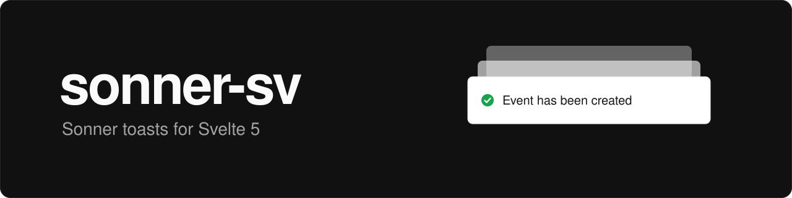

# sonner-sv

[Sonner](https://sonner.emilkowal.ski/) by [Emil Kowalski](https://emilkowal.ski), ported to Svelte 5. Same toasts, same API, minus the React.

Docs and live examples:

- For humans: [demo site](https://tiberiusnemesis.github.io/sonner-sv/)
- For agents (and anyone who likes tables): [`docs/API.md`](https://github.com/TiberiusNemesis/sonner-sv/blob/main/docs/API.md)

## Install

It's not on npm yet, so you gotta grab the prebuilt package from the `release` branch (CI keeps it in sync with `main`):

```bash
pnpm add github:TiberiusNemesis/sonner-sv#release
```

Needs Svelte `5.29` or newer.

## Usage

Drop `<Toaster />` in your root layout:

```svelte
<script>
	import { Toaster } from 'sonner-sv';

	let { children } = $props();
</script>

<Toaster />
{@render children()}
```

Then call `toast()` from anywhere, plain `.ts` files included:

```svelte
<script>
	import { toast } from 'sonner-sv';
</script>

<button onclick={() => toast('My first toast')}>Give me a toast</button>
```

Coming from React Sonner? Snippets replace JSX and `class` replaces `className`. The rest is in [`docs/API.md`](https://github.com/TiberiusNemesis/sonner-sv/blob/main/docs/API.md#differences-from-the-react-version).

## License

MIT. Sonner is © Emil Kowalski, see [LICENSE](./LICENSE).
